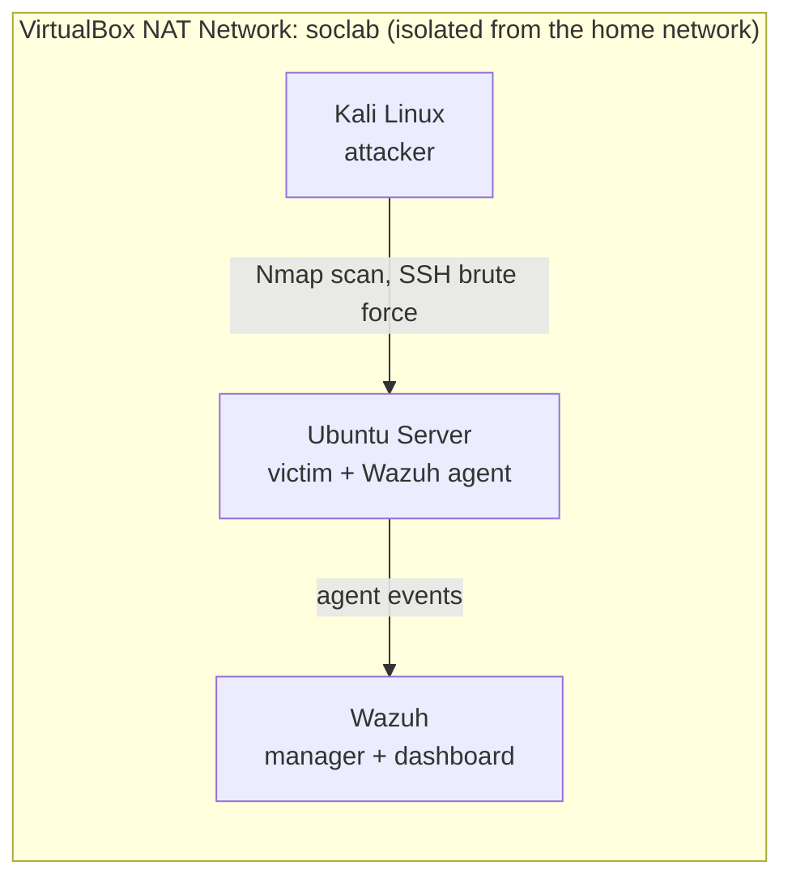

# Attack-Detect-Harden: Home SOC Lab

A hands-on cybersecurity project where I **attacked** a deliberately weak Linux server, **detected** the attacks with a SIEM (Wazuh), **hardened** the server with a Bash script, and then **measured** the improvement with before-and-after results.

Everything runs in an isolated virtual lab on my laptop. No real systems were targeted.

## Results at a glance

| Metric | Before | After |
|---|---|---|
| Lynis hardening index | 66 | 82 |
| Lynis warnings | 0 | 0 |
| Lynis suggestions | 35 | 26 |
| Open ports (Nmap, all 65535) | 22 (SSH) | 22 (SSH) |
| Host firewall (UFW) | Inactive | Active |
| SSH password login | Enabled | Disabled |
| SSH brute-force outcome | Successful | Fails |

Full breakdown: [`reports/before-after.md`](reports/before-after.md). Incident write-up: [`reports/incident-report.md`](reports/incident-report.md).

## What this project demonstrates

- Building and segmenting a virtual lab network
- Deploying a SIEM (Wazuh) and connecting an endpoint agent
- Running reconnaissance and credential attacks, and finding them in the logs
- Establishing a security baseline with Lynis and Nmap
- Remediating findings with an automated, repeatable Bash hardening script
- Verifying fixes by re-running the same attacks and measurements
- Documenting findings in an incident-report format

## Lab architecture



| VM | Role | Notes |
|---|---|---|
| Kali Linux | Attacker | Runs the scans and brute-force attempts |
| Ubuntu Server | Victim | OpenSSH enabled, deliberately weak password, generic lab username |
| Wazuh (OVA) | SIEM | 6 GB RAM, collects and alerts on victim logs |

**Host:** Windows 11 laptop, 16 GB RAM, VirtualBox.

**Network:** the VMs share a VirtualBox *NAT Network* (`soclab`). They can reach each other and the internet, but stay off my home network. I chose this over Bridged mode so the intentionally vulnerable VM is never exposed to real devices.

## Project phases

1. **Repo and lab notebook:** semi-structured repo plus a running log in [`notes/lab-log.md`](notes/lab-log.txt).
2. **Network and victim VM:** built the isolated network and the weak Ubuntu server.
3. **Wazuh and agent:** installed Wazuh and connected the victim as an active agent.
4. **Baseline:** recorded Lynis, Nmap and firewall state *before* any changes ([`reports/lynis-baseline.md`](reports/lynis-baseline.txt)).
5. **Attack and detect:** port scan and SSH brute force from Kali; reviewed the alerts in Wazuh.
6. **Harden:** wrote (AI Assisted) [`scripts/harden-victim.sh`](scripts/harden-victim.sh), driven by the Lynis suggestions, and applied it.
7. **Verify and report:** re-ran the attacks and measurements, then wrote this up.

## Attacks and detection

| Attack | Tool | What Wazuh showed |
|---|---|---|
| Port scan | Nmap | No alert, possibly because I didn't configure it to or because I used -sS in the initial nmap scan |
| SSH brute force | Hydra | High-severity alert on every attempt. Rule: Brute Force (T1110) |
| Login with the weak password | SSH | Valid Accounts (T1078) |


## What I hardened

The script is idempotent, backs up every config before changing it, and is built so it can't lock me out of SSH. Highlights:

- **Firewall:** UFW default-deny inbound, SSH only and rate-limited
- **SSH:** key-based login, password login and root login disabled, 3 attempts max, only the lab user allowed
- **Brute-force defense:** fail2ban bans repeat offenders
- **Accounts:** password strength rules, aging, expiry, stronger hashing settings, stricter umask
- **Kernel and network:** expanded sysctl hardening
- **Attack surface:** unused protocols, filesystems and USB storage disabled; compilers restricted to root
- **Visibility:** auditd rules, process accounting, login banners
- **Maintenance:** automatic security updates

Each fix maps to a Lynis control ID. Suggestions I intentionally skipped (for example, separate `/home` and `/var` partitions) are documented as accepted risks with reasons in [`reports/before-after.md`](reports/before-after.md).

## Challenges and what I learned

- **`scp` "connection refused":** I was pulling a file from Kali, which doesn't run an SSH server by default. Lesson: the machine you connect *to* must be running `sshd`, so I pushed from Kali to the victim instead.
- **sshd setting precedence:** sshd uses the *first* value it reads, and cloud-init ships a config that re-enables password login. Naming my drop-in `00-hardening.conf` makes it load first.
- **Wazuh SCA page was empty:** unresolved. I used Lynis and Nmap as the primary before/after metrics instead. [I'll update if I fix this]
- **Verify, don't assume:** I confirmed the changes were made after running the script.

## Repository structure

```
Attack-Detect-Harden/
├── README.md
├── notes/          lab log
├── reports/        baseline reports from lynis and nmap, hydra attack, incident report
├── scripts/        harden-victim.sh
└── screenshots/    evidence from each phase
```

## AI assistance

I used Claude (Anthropic) as a learning and drafting aid on this project. It helped draft `harden-victim.sh`, some documentation templates, and the report structure to make it easy to interpret for readers. I designed the lab, ran every attack and scan, tested and verified the results, and made the decisions about what to harden and which risks to accept. I reviewed the script to understand each section before running it.

## Safety and ethics

All attacks were run only against VMs I own, on an isolated virtual network. The weak password exists only in that lab. Do not use these techniques against systems you don't own or have explicit permission to test.

## Possible future work

- Wazuh Active Response to block attacker IPs automatically
- Custom Wazuh rules and dashboards
- File integrity monitoring on the hardened host
- Adding a honeypot to the lab
